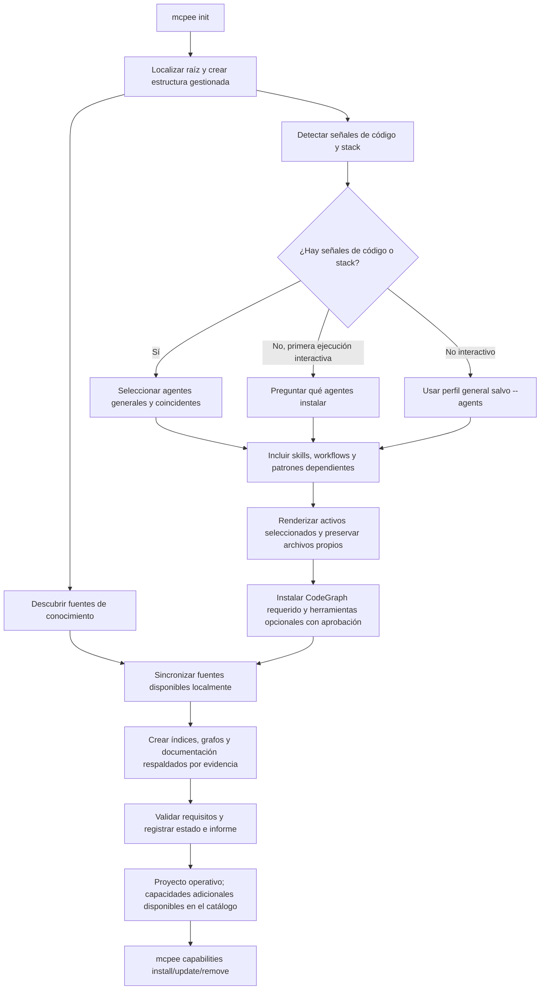
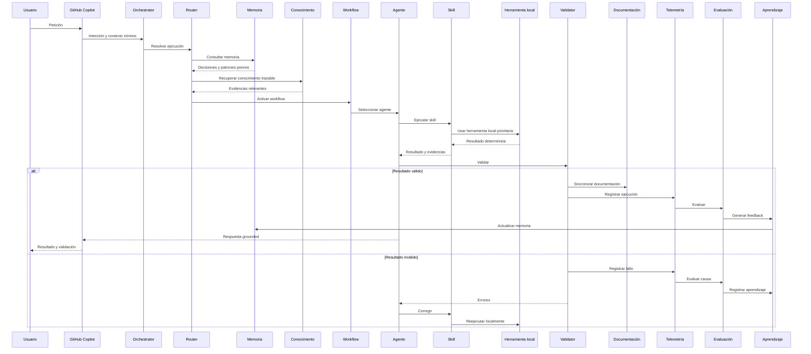
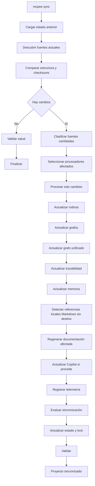

# MCPEE — Arquitectura objetivo y funcionamiento actual

## 1. Propósito

**MCPEE** es una plataforma **local-first**, instalable mediante npm, que prepara cualquier proyecto para trabajar con GitHub Copilot mediante un sistema centralizado de:

- conocimiento;
- agentes especializados;
- skills reutilizables;
- workflows;
- patrones y plantillas;
- herramientas locales;
- routing;
- memoria;
- grafos e índices;
- documentación técnica automática;
- telemetría;
- observabilidad;
- evaluación;
- autoaprendizaje.

MCPEE se instala sobre un **proyecto**, no sobre el concepto de repositorio Git. El proyecto puede contener una o varias aplicaciones o repositorios, ser un monorepo, contener solo documentación, no tener código todavía o no utilizar Git.

En proyectos brownfield, la sincronización inicial produce propuestas separadas por dominios candidatos y un índice Markdown de revisión. La agrupación usa directorios y familias de nombres, no semántica de negocio confirmada. Cada propuesta limita su mapa a 20 fuentes, muestra declaraciones estáticas con líneas y ofrece casos positivos, negativos y de frontera en catálogos Markdown paginados; distingue las pruebas declaradas de los casos propuestos y de los resultados realmente ejecutados. Los manifiestos JSON conservan hashes y procedencia, pero no son la interfaz de lectura. La especificación solo se vuelve normativa tras completar comportamiento y criterios verificables y ratificar explícitamente el hash revisado con una persona responsable; fuentes modificadas generan drift y nunca reescriben documentos aprobados. Su contenido se incorpora antes de aprobar la transferencia a Copilot en todos los modos de contexto; el ejecutor rechaza hashes obsoletos y evita el truncado silencioso. El formato es neutral respecto a Spec Kit/OpenSpec. Ver [descubrimiento de especificaciones brownfield](BROWNFIELD-SPECS.md).

El grafo unificado se construye antes del descubrimiento de especificaciones. Las propuestas reutilizan referencias locales explícitas entre fuentes incluidas, con enlaces al origen y al destino y hashes de ambos. Los destinos referenciados participan en el drift aunque estén en otro dominio o parte de la propuesta; un import desde un test no acredita cobertura. El descubrimiento independiente sin grafo declara la ausencia de relaciones y un grafo obsoleto exige sincronización.

**Estado de esta especificación:** combina arquitectura objetivo y comportamiento actual; no implica que cada capacidad objetivo ya esté implementada. Las secciones marcadas como flujo objetivo no son una promesa de runtime. El alcance disponible y sus limitaciones se mantienen en `README.md` y en la ayuda de `mcpee`.

**Contrato de aceptación:** los límites de certificación están en [Release acceptance boundaries](DEVELOPMENT.md#release-acceptance-boundaries). Una prueba controlada del harness no certifica la aplicación, la calidad de especialistas ni toda esta arquitectura. El registro MCP vigente usa `.mcp.json` en la raíz del proyecto; `.vscode/mcp.json` solo aparece como origen de migración para proyectos antiguos. Las normalizaciones equivalentes del host se conservan sin sobrescribir su configuración.

**Distribución 0.1.31:** se publica en el repositorio `Sertxito/mcp-efficiency-engine` y en el paquete npm `mcp-efficiency-engine`, con los comandos `mcpee` y `mcp-efficiency-engine`. Requiere Node.js 24 o superior. La instalación npm no ejecuta `init` ni instala herramientas del proyecto: se inicializa el workspace de forma explícita, sin migración previa. La [resolución de problemas](TROUBLESHOOTING.md) cubre errores de instalación e indexación, y la [publicación](RELEASING.md) usa la versión confirmada en los manifiestos, sin incrementarla de forma oculta en CI.

El protocolo Node/Python utiliza UTF-8 estricto, también con pipes en Windows, independientemente de la página de códigos de la consola. La caché conserva los vectores cuyo contenido y metadatos coinciden; las entradas mal decodificadas por versiones anteriores no coinciden con los chunks corregidos y se recalculan sin borrar los pesos del modelo.

La inferencia BGE-M3 en CPU limita cada lote a 16 textos y 4.096 tokens con padding, manteniendo el máximo de 4.000 tokens por chunk y guardando cada lote completado. Los eventos de progreso medido se escriben en stderr también al redirigirlo a un log, salvo con flags de salida de máquina. El heartbeat de actividad sigue siendo exclusivo de la terminal y no acredita avance de inferencia.

El paquete contiene el catálogo completo de capacidades reutilizables. `mcpee init` instala automáticamente las capacidades generales y las que encajan con la evidencia de código y el stack detectado; si el proyecto no tiene señales de código, el init interactivo permite elegir agentes y agrega sus skills, workflows y patrones dependientes. `--agents <id,...|all|none>` permite fijar esa selección en scripts. En modo no interactivo, sin selección explícita, se conserva el perfil general seguro. El resto queda disponible para instalación, actualización o retirada mediante `mcpee capabilities`. Esta selección por proyecto evita instalar agentes y procedimientos ajenos al stack sin limitar su disponibilidad desde el catálogo. La creación de estructura, configuración, hooks e instrucciones de Copilot no requiere reemplazar archivos del usuario; cada descarga de herramienta requiere aprobación individual. Después, `init` descubre ejecutables catalogados y ejecuta una primera sincronización local de fuentes. Una raíz de MCPEE puede contener varias aplicaciones y repositorios anidados; `knowledge.sourceRoots` selecciona directorios relativos a esa raíz y el índice, el grafo y CodeGraph operan sobre ese workspace común. No se admiten fuentes externas a la raíz. La sincronización construye un grafo unificado de evidencia en `.mcpee/graphs/unified/graph.json`, conectando registros de fuente, categorías, representaciones normalizadas, encabezados extraídos y símbolos locales mediante aristas trazables. También conecta enlaces Markdown e imports locales estáticos JavaScript/TypeScript; etiqueta por separado los imports de tests, extrae módulos Terraform/Bicep, `$ref` de contratos/configuración, acciones locales de pipelines y tablas y referencias FK explícitas en SQL. Cada arista conserva línea y checksum; relaciones ambiguas, dinámicas o inferidas se omiten. Un edge `tests_source` acredita únicamente un import local explícito desde un archivo clasificado como test; no demuestra cobertura ni que las aserciones ejerciten ese módulo. El grafo no afirma relaciones semánticas generales. El índice ofrece búsqueda léxica y similitud TF-IDF dispersa como fallback, y dos perfiles semánticos locales seleccionables: `light` usa Ollama con `embeddinggemma`; `bge-m3` ejecuta `BAAI/bge-m3` en CPU desde un entorno Python local y aislado. El perfil ligero exige Ollama ya instalado y solicita aprobación antes de descargar el modelo (aproximadamente 0,6 GB). BGE-M3 solicita aprobación antes de instalar dependencias fijadas y descargar pesos; usa lotes de 16, chunks de hasta 4.000 tokens medidos por el tokenizador, conserva tablas menores en un solo chunk, repite sus cabeceras al dividirlas y mantiene 15% de solapamiento entre chunks de código. Persiste un índice denso FAISS, datos léxicos BM25 y fusión RRF. Indexado y consulta funcionan offline, la telemetría del Hub está deshabilitada y ningún perfil envía fuentes a un endpoint remoto. `mcpee knowledge context` empaqueta extractos originales relevantes con ruta, líneas normalizadas y checksum bajo un presupuesto aproximado de tokens; no genera resúmenes mediante modelo. El índice de embeddings se debe refrescar después de cambios en fuentes; si está ausente o desactualizado, la recuperación de contexto vuelve al índice léxico. El detector de drift encuentra enlaces Markdown locales rotos, afirmaciones Markdown ancladas con modalidades explícitas opuestas, discrepancias con valores booleanos de configuración, desacuerdos explícitos entre flags booleanos JavaScript/TypeScript y aserciones simples de tests, y contradicciones con el evento de salud más reciente de CodeGraph; solo produce candidatos para revisión y no infiere semántica general ni comportamiento runtime. CodeGraph es un componente requerido: `init` debe instalarlo con aprobación, inicializar su grafo en `.codegraph/` —la carpeta raíz única admitida por `CODEGRAPH_DIR` en CodeGraph 1.6.2— y registrar un servidor MCP solo para el workspace en `.mcp.json`; `sync` debe actualizar ambos grafos y falla si CodeGraph no está disponible. El MCP no se instala globalmente, CodeGraph no usa watcher, comprobación de actualizaciones, telemetría ni descarga de runtime de respaldo. No instala GitNexus automáticamente por su licencia PolyForm Noncommercial ni modifica runtimes globales. Comprueba la última versión LTS de Node.js; como Python no tiene una versión LTS oficial, instala y gestiona la última versión estable de Python dentro de `.mcpee/tools/` usando una versión fijada de uv. La primera instalación de uv necesita un Python 3.8+ con pip únicamente como runtime de arranque. Las relaciones semánticas inferidas entre fuentes siguen sin implementarse.

En cada `init`, MCPEE inspecciona evidencias locales y reproducibles (extensiones de proyecto, manifiestos de dependencias y archivos de infraestructura/pipelines), omite directorios de dependencias, build, generados y control de versiones, y genera `.mcpee/generated/project-capabilities.json` más un informe Markdown. El perfil enlaza stack detectado con roles, skills, workflows, patterns, playbooks, guías técnicas, scorecards, casos de evaluación y ejemplos de prompts del catálogo propio de MCPEE; las guías coincidentes se materializan como instrucciones Copilot con `applyTo` limitado a los tipos de archivo relevantes. Las fuentes de plantillas se incluyen completas en el catálogo renderizado del proyecto. Una detección vacía no inventa tecnologías y queda reportada explícitamente. `mcpee explain` expone el perfil persistido; volver a ejecutar `init` lo recalcula y actualiza los archivos que MCPEE administra sin sustituir archivos del usuario.

El catálogo se puede administrar después de inicializar el proyecto con `mcpee capabilities list|install|update|remove`. La selección por proyecto y sus overrides se guardan en `.mcpee/state/catalog-capabilities.json`; `list` distingue recursos instalados, disponibles y core, mientras que los recursos core (políticas y capacidades de herramientas) no se pueden retirar individualmente. Al instalar un agente, workflow o playbook se habilitan sus dependencias catalogadas; al retirar, MCPEE conserva recursos compartidos y rechaza la operación si otro recurso instalado depende del objetivo. El renderer actualiza solo archivos del manifiesto generados por MCPEE y conserva los archivos personalizados del proyecto. El routing utiliza exclusivamente workflows, agentes y recursos activos del catálogo instalado.

La auditoría local del harness (`mcpee assets audit`) escanea rutas conocidas de instrucciones, agentes, skills, hooks y configuración de herramientas con límites de tamaño y cantidad, evita seguir enlaces simbólicos y nunca incluye valores coincidentes de posibles credenciales en la salida. Sus resultados son heurísticos y declaran cobertura; no reparan archivos ni certifican ausencia de vulnerabilidades. `mcpee skills health` relaciona los resultados persistidos de evaluaciones de workflows con sus skills asignadas y comunica explícitamente que es una métrica proxy, no atribución causal. `mcpee plan init` crea bajo `.mcpee/planning/<id>/` una especificación y un plan de entrega versionables, no sobrescribe artefactos existentes y los deja como borrador pendiente de revisión humana.

`mcpee evaluate --case <id> --asset <id> --response <file>` añade evaluación de respuestas sin servicios de modelos: valida ruta y tamaño locales, ejecuta solo las aserciones literales declaradas por el caso y produce `awaiting-review` hasta recibir una rúbrica humana completa mediante `--ratings <json> --reviewer <name>`. Cada criterio recibe 0–2 y evidencia; solo los resultados revisados se usan como evidencia directa de salud para el asset declarado. Los informes persistidos en `.mcpee/reports/asset-evaluations/` guardan hash y tamaño de respuesta, checks y puntuaciones, pero no el texto evaluado. Los checks literales son smoke tests, no calificadores semánticos; el reviewer y sus puntuaciones son atestaciones registradas, no hechos verificados por MCPEE.

`mcpee coverage` valida el contrato versionado `catalog/coverage.json`: cada tecnología reconocida por el detector debe mapear referencias existentes para agente, skill, workflow, guía técnica, patrón, scorecard, caso de evaluación, prompt y una base de descubrimiento de validación. `mapped` solo significa que el mapeo requerido está completo y referencialmente válido; el contrato no certifica exhaustividad, calidad ni compatibilidad de todas las versiones. `mcpee quality` mide por proyecto qué tecnologías detectadas tienen checks explícitamente asociados, enlazados a evidencia local y con resultados observados. Los checks generados se asocian automáticamente solo si su evidencia de configuración también es evidencia directa de esa tecnología; los demás requieren que el proyecto declare `covers_technologies` en el paso del workflow. `mcpee quality --strict` falla ante gates ausentes, bloqueados o no ejecutados, y devuelve un estado distinto para checks fallidos. Ningún resultado declara que un comando personalizado cubra todas las convenciones del stack: el comando y su cobertura siguen siendo responsabilidad del proyecto.

Las aristas del grafo unificado incluyen `provenance.kind` (`source_manifest`, `generated_artifact`, `parsed_document_structure`, `source_extraction` o `explicit_source_reference`) y `provenance.inferred: false`, además de la ruta, checksum y localizador cuando existen. MCPEE omite relaciones semánticas inferidas o ambiguas; la procedencia distingue declaraciones/referencias explícitas de estructura extraída, no asigna confianza semántica ni equivale a análisis runtime.

---

## 2. Principios innegociables

1. **Local-first**: cualquier operación determinista que pueda resolverse localmente se ejecuta antes de recurrir al modelo.
2. **Knowledge-first**: todas las fuentes de verdad del proyecto se registran y tratan como conocimiento.
3. **Memory-first**: antes de recuperar o recalcular información, se consulta la memoria aplicable.
4. **Minimum context**: solo se proporciona al agente el contexto necesario.
5. **Evidence required**: toda decisión relevante debe relacionarse con sus fuentes y resultados.
6. **Impact before change**: antes de modificar código o arquitectura se analiza el impacto.
7. **Validation required**: ninguna operación se considera completa sin validación.
8. **Documentation always**: todo cambio validado actualiza la documentación técnica afectada.
9. **Telemetry always**: toda ejecución relevante genera eventos estructurados.
10. **Observability always**: routing, herramientas, contexto, validaciones y fallbacks son observables.
11. **Learning always**: los resultados y evaluaciones alimentan memoria y patrones.
12. **Source traceability**: el conocimiento derivado conserva la relación con su fuente original.
13. **Human approval**: los cambios de estado, escrituras, acciones destructivas, despliegues, cambios de permisos y salidas externas requieren autorización humana explícita para la acción concreta. Solo las operaciones verificadas como lectura pueden continuar automáticamente.

En la implementación actual, la política compartida clasifica herramientas y comandos; los hooks de Copilot CLI/cloud y VS Code Local devuelven `allow`, `ask` o `deny`, y la sesión SDK permite lecturas verificadas, solicita confirmación MCPEE antes de cada otra llamada y devuelve `allow` solo tras la aprobación humana. En VS Code, el hook Local requiere harness Local, workspace de confianza y hooks activados; esta capacidad está documentada como Preview. Antes de `run`, MCPEE calcula y presenta impacto sobre las fuentes del plan de routing; cada mutación de archivo necesita un destino explícito, cuyo análisis/checksum se valida de nuevo inmediatamente antes de mostrar la aprobación. Las llamadas de mutación se bloquean si el destino no puede verificarse; las otras acciones state-changing requieren preflight listo y aprobación para la llamada concreta. Los workflows presentan el impacto de sus fuentes declaradas antes de ejecutar pasos y bloquean los state-changing si falta evidencia indexada; la aprobación humana de cada paso sigue siendo necesaria. Tras cualquier mutación de archivo observada, incluso si la sesión de Copilot termina con error, `run` solicita aprobación separada para actualizar índices y grafos, ejecuta el spec `.mcpee/workflows/<workflow-id>.json` con aprobación por paso y regenera documentación solo si la validación pasa. Si el spec falta o falla, informa que la finalización está incompleta y deja intacta la documentación generada. Cada sesión con evento de ejecución guarda un informe de las ocho etapas en `.mcpee/reports/runs/`; sus estados se calculan desde routing, preflight, eventos de sesión, workflow local, documentación y telemetría, no desde un checklist narrado por el modelo. Las etapas sin acción aplicable se marcan explícitamente; una validación ausente, una aprobación denegada o una sincronización fallida no se presenta como completada. Los checks de evaluación/workflow bloquean pasos no verificados si no reciben autorización interactiva. Los permisos de runtime requieren confirmación para la acción concreta y se deniegan sin terminal interactivo. Los permisos nativos del host siguen habilitados como defensa adicional, y los nombres/esquemas de herramientas deben verificarse para cada harness.

En el producto objetivo, las capacidades base no son opciones parciales. Las herramientas externas se detectan y gestionan mediante el catálogo: las aprobadas se instalan automáticamente en el entorno local del proyecto, mientras las excluidas por licencia o política requieren una decisión explícita.

La versión actual integra el chat normal mediante el servidor MCP de proyecto `mcpee_run`: las instrucciones generadas piden usarlo para las tareas de ingeniería y el servidor ejecuta `mcpee run` con grounding predeterminado. `mcpee init` registra el servidor junto a CodeGraph en `.mcp.json`, el formato portable que leen directamente las sesiones Copilot harness; no requiere extensión VSIX ni mención especial. Los proyectos existentes que conserven las entradas en `.vscode/mcp.json` deben migrarlas una vez desde VS Code. Para aprobar la transferencia de contexto y las acciones, usa MCP elicitation mediante un broker local autenticado; si el host no anuncia soporte para formularios de elicitation, la ejecución falla cerrada.

---

## 3. Conceptos eliminados

- Boost
- Instalación indiscriminada de todos los activos del catálogo
- Bundles y presets como mecanismos separados del catálogo
- Modo greenfield
- Modo brownfield
- Selección de estrategia de cambios
- Selección de privacidad
- Selección de documentación, memoria, telemetría, observabilidad o aprendizaje

No se mantienen como alias ni como capas internas de compatibilidad.
`capabilities` es el comando vigente para administrar activos del catálogo;
no se ha eliminado ni sustituido por esos conceptos antiguos.

---

## 4. Host y experiencia de uso

El único host soportado inicialmente es **GitHub Copilot**.

- **GitHub Copilot Chat**: experiencia principal de trabajo diario.
- **GitHub Copilot CLI**: ejecución avanzada y automatización.
- **MCPEE CLI**: instalación, sincronización, diagnóstico, explicación, reconstrucción y actualización.

Para el uso diario en VS Code, Copilot Chat invoca el `mcpee_run` MCP tool desde la conversación normal; MCPEE enruta y ejecuta la tarea mediante su runtime de Copilot CLI, y devuelve el resultado como respuesta de herramienta en esa misma conversación.

---

## 5. El proyecto como unidad raíz

La unidad raíz de MCPEE es el **proyecto**. Puede incluir uno o varios repositorios, aplicaciones, código, documentación, infraestructura, esquemas, pipelines, tests, contratos, scripts y datos operativos.

MCPEE no depende de una carpeta `src`. El detector reconoce estructuras habituales y permite registrar otras rutas sin cambiar el modelo.

---

## 6. Todo es conocimiento

MCPEE considera conocimiento cualquier fuente de verdad disponible en el proyecto:

- código fuente;
- documentación funcional, de negocio y técnica;
- configuración;
- infraestructura;
- pipelines;
- esquemas y migraciones;
- contratos API;
- tests;
- ADRs;
- scripts;
- logs y telemetría;
- decisiones y validaciones.

Las fuentes tienen autoridades diferentes:

- documentación de negocio: intención, reglas y procesos;
- código: implementación actual;
- tests: comportamiento validado;
- infraestructura: despliegue declarado;
- configuración: comportamiento configurado;
- telemetría: comportamiento observado;
- decisiones: razonamiento y restricciones.

La arquitectura objetivo detecta contradicciones entre intención, implementación, validación y ejecución observada sin mezclarlas ni ocultarlas. La implementación actual detecta enlaces Markdown locales sin destino y afirmaciones documentales opuestas que comparten un ancla Markdown explícita y modalidad de requisito, disponibilidad, soporte o permiso. Estas últimas son candidatas léxicas para revisión humana; no se presentan como conclusiones semánticas definitivas.

---

## 7. Pipeline único de conocimiento

```text
Fuente
  -> Inventario
  -> Clasificación
  -> Extracción
  -> Normalización
  -> Trazabilidad
  -> Indexación
  -> Grafos especializados
  -> Grafo unificado
  -> Memoria
  -> Agentes
```

Cada fuente utiliza el procesador local adecuado:

```text
Documentos -> MarkItDown -> Markdown normalizado -> índice -> grafo
Código -> analizador local -> símbolos y flujos -> índice -> grafo de código
Infraestructura -> parser específico -> recursos y relaciones -> grafo
Tests -> análisis local -> relación comportamiento-código -> evidencias
```

El código permanece en su ubicación real. MCPEE lo registra y proyecta mediante índices, grafos, metadatos y documentación derivada.

---

## 8. Modelo conceptual

```text
Project
├── Sources
├── Knowledge
├── Agents
├── Skills
├── Workflows
├── Patterns
├── Templates
├── Policies
├── Tools
├── Memory
├── Documentation
├── Telemetry
├── Observability
├── Evaluation
└── Learning
```

- **Project**: unidad raíz.
- **Source**: fuente de verdad detectada o incorporada.
- **Knowledge**: representación local, consultable y trazable.
- **Agent**: especialista que razona y actúa.
- **Skill**: procedimiento reutilizable.
- **Workflow**: secuencia coordinada de agentes, skills, herramientas y validaciones.
- **Pattern**: solución reusable.
- **Template**: estructura estándar de un artefacto.
- **Policy**: regla obligatoria. si hace falta forzar con hooks.
- **Tool**: programa, CLI, script o integración.
- **Memory**: conocimiento derivado de decisiones y ejecuciones.
- **Learning**: actualización controlada de memoria y patrones.

---

## 9. Repositorio central de MCPEE

```text
mcpee/
├── packages/
│   ├── asset-audit/
│   ├── cli/
│   ├── copilot-renderer/
│   ├── core/
│   ├── documentation-engine/
│   ├── evaluation-engine/
│   ├── execution-engine/
│   ├── knowledge-engine/
│   ├── learning-engine/
│   ├── mcp-server/
│   ├── memory-engine/
│   ├── planning-engine/
│   ├── routing-engine/
│   ├── source-engine/
│   ├── tool-manager/
│   ├── validation-engine/
│   ├── vscode-chat/
│   └── workflow-engine/
├── agents/                 # canonical role assets
├── catalog/                # catalog and routing/coverage/tool JSON contracts
├── docs/
├── instructions/           # official-source-backed technical guidance
├── playbooks/
├── prompts/                # prompt examples
├── schemas/
├── skills/
├── templates/
├── tests/
├── workflows/
├── scripts/                # development-time package/documentation checks
├── package.json
└── README.md
```

### Implementación actual

Los directorios de `packages/` son la estructura real; no hay paquetes
independientes llamados `project-detector`, `source-discovery`,
`telemetry-engine`, `observability-engine`, `installer`, `synchronizer` o
`validator`. Sus responsabilidades actuales se distribuyen así:

- `cli` y `core`: comandos, inicialización del proyecto, contratos, eventos y
  ciclo de vida.
- `copilot-renderer`: validación, selección y materialización del catálogo;
  también detecta capacidades tecnológicas del proyecto.
- `source-engine` y `knowledge-engine`: discovery y procesamiento local de
  fuentes, índices y grafos de evidencia.
- `tool-manager`: descubre, instala con aprobación, valida e invoca herramientas
  locales catalogadas.
- `routing-engine`, `execution-engine`, `workflow-engine` y `mcp-server`:
  planificación determinista, ejecución Copilot, workflows aprobados e
  integración MCP.
- `memory-engine`, `documentation-engine`, `evaluation-engine`,
  `learning-engine`, `planning-engine` y `validation-engine`: memoria,
  documentación, evaluación, propuestas de aprendizaje, planes y quality gates.
- `asset-audit`, `vscode-chat`: auditoría local de activos e integración de
  experiencia Copilot para VS Code.

La separación futura en motores más pequeños puede considerarse una refactoría
de implementación; no debe documentarse como paquetes existentes hasta que se
creen y se prueben.

---

## 10. Catálogo central

```text
catalog/
├── agents/
├── skills/
├── workflows/
├── playbooks/
├── patterns/
├── templates/
├── policies/
├── tools/
└── source-processors/
```

Existe una sola definición canónica de cada elemento. El proyecto consumidor recibe una materialización generada.

### Agentes

```text
orchestrator
business
product
architecture
frontend
backend
data
ai
database
qa
security
devops
infrastructure
ux-ui
documentation
observability
legacy
```

Cada agente declara responsabilidad, límites, skills, conocimiento preferente, herramientas, policies, evidencias y colaboración con otros agentes.

Las policies tienen una única fuente en `catalog/catalog.json`: se renderizan
como instrucciones globales y los perfiles de agentes enlazan ese contrato,
sin mantener copias independientes. El contexto SDK recibe las mismas
descripciones, modos de enforcement y requisitos de evidencia. Los hooks y las
aprobaciones del runtime siguen imponiendo sus límites; el Markdown no sustituye
esos controles.

Las instrucciones técnicas se separan por C#/.NET, Python, Node.js, JavaScript/TypeScript,
Angular, React, Vue, SQL, Cosmos DB, Bicep, Terraform y pipelines YAML, además de las
guías cloud. Cada entrada declara `technologies` y globs `apply_to` explícitos.
Un proyecto mixto recibe guías separadas, no una guía cuyo nombre decida qué
lenguaje prevalece. Los globs amplios de frameworks no sustituyen comprobar el
componente concreto en un monorepo. Los overrides de guías combinadas anteriores
se expanden a los nuevos IDs al refrescar las capacidades.

El routing selecciona guías instaladas por términos técnicos y rutas explícitas
del índice; si no identifica una guía, incluye las del stack instalado con sus
metadatos de aplicación para no perder el contexto técnico. La skill de
rendimiento exige objetivo numérico, baseline reproducible, muestras repetidas,
variación, comparación equivalente y comprobaciones de corrección y recursos.
El resultado es pass/fail/inconclusive; la ausencia de datos o permisos no se
presenta como una optimización validada. Los tests y rúbricas comprueban el
contrato, no certifican que todo resultado de un modelo vaya a ser correcto.

La [matriz de recuperación de boosts](BOOST-CAPABILITY-COVERAGE.md) enlaza las
capacidades originales con sus destinos y exclusiones. La recuperación amplía
las skills existentes y añade diagnóstico SQL y ensayo de recuperación, no una
copia de cada agente, conector o script antiguo. El diagnóstico exige código,
planes/esperas y regresión funcional; la recuperación exige RTO/RPO medidos,
integridad de la aplicación y aprobación por acción en un entorno aislado.
El detector reconoce Vue/Nuxt o fuentes `.vue`, selecciona el rol frontend y
sus guías explícitas. Los originales y los proyectos privados no se modifican.

### Skills

```text
knowledge
analysis
business
architecture
implementation
quality
documentation
operations
```

Una skill existe una vez y puede ser utilizada por varios agentes o workflows.
El catálogo valida que las asignaciones declaradas en ambas direcciones
coincidan y renderiza sus procedimientos y consumidores.

### Workflows

```text
understand-project
ingest-knowledge
deliver-feature
resolve-bug
refactor-code
change-architecture
review-security
modernize-legacy
synchronize-documentation
diagnose-operation
evaluate-execution
```

Todos declaran las mismas etapas y además especifican condiciones de entrada,
agente coordinador, skills y entregables:

```text
Understand -> Analyze -> Plan -> Execute -> Validate -> Document -> Observe -> Learn
```

### Policies

```text
local-first
memory-first
minimum-context
evidence-required
source-traceability
impact-before-change
validation-required
human-in-the-loop
documentation-always
telemetry-always
observability-always
learning-always
no-unverified-claims
```

### Tools

```text
git
node
npm
python
dotnet
azure-cli
aws-cli
markitdown
codegraph
gitnexus
graphify
repomix
```

Las herramientas son IDs ejecutables y deben coincidir con el inventario de
instalación. Capacidades como `linters`, `test-runners`, `framework-clis` y
`optional-mcp` se catalogan por separado: describen tipos de integración, no
comandos garantizados en la máquina. MCP es un adaptador opcional, no el núcleo
ni una dependencia obligatoria.

### Playbooks, patterns y templates

Los playbooks declaran en `catalog.json` una fuente Markdown, palabras clave y
workflows relacionados. El routing incorpora el contenido completo solo cuando
la tarea coincide; el renderer valida sus secciones y referencias, lo incluye
en el hash del catálogo y publica `.mcpee/generated/catalog-playbooks.md`.
`migration-strategy` gobierna la elección de estrategia desde evidencia del
estado actual, la comparación de alternativas, dependencias y etapas de corte,
validación paralela y de datos, compatibilidad de consumidores, observabilidad,
recuperación hacia delante o rollback, aprobaciones y retirada del sistema
anterior. El playbook exige distinguir controles propuestos de controles
implementados y probados. Planificar no autoriza ejecutar una migración.

El catálogo declara patrones con sus casos de uso, pasos y anti-patrones, y
templates con ruta fuente, casos de uso y variables. El renderer publica índices
locales en `.mcpee/generated/catalog-patterns.md` y
`.mcpee/generated/catalog-templates.md`; las fuentes de templates se mantienen
en `templates/`. Las fuentes referenciadas deben permanecer dentro del paquete
y existir.
El `catalog-lock.json` incluye el contenido de los catálogos auxiliares y de
cada template referenciado para detectar cambios de integridad.

Las carpetas de autoría `agents/`, `skills/` y `workflows/` contienen una base
ampliada para modelar el ciclo de vida de un proyecto. No son otra fuente
canónica ni se cargan en runtime: el catálogo central conserva esa autoridad.
Cada definición seleccionada debe revisarse y mapearse allí antes de aparecer
en routing o en los artefactos generados para un proyecto consumidor.

### Source processors

```text
source-code
markdown
office-documents
pdf
structured-data
infrastructure
database
api-contracts
pipelines
tests
configuration
logs
```

Cada procesador declara formatos, herramienta local, extracción, normalización, indexación, relaciones, checksum, procesamiento incremental y fallback.

---

## 11. Estructura instalada en cualquier proyecto

```text
project/
├── .github/
│   ├── copilot-instructions.md
│   ├── agents/
│   ├── instructions/
│   ├── prompts/
│   └── skills/
├── .mcpee/
│   ├── generated/
│   ├── state/
│   ├── cache/
│   ├── indexes/
│   ├── graphs/
│   ├── memory/
│   ├── telemetry/
│   ├── observability/
│   ├── learning/
│   ├── logs/
│   ├── reports/
│   └── catalog-lock.json
├── knowledge/
│   ├── sources/
│   │   ├── business/
│   │   ├── technical/
│   │   ├── architecture/
│   │   ├── infrastructure/
│   │   ├── data/
│   │   ├── operations/
│   │   └── external/
│   ├── normalized/
│   ├── extracted/
│   ├── traceability/
│   └── generated/
├── docs/
│   └── generated/
├── mcpee.config.yml
└── contenido-real-del-proyecto/
```

Las carpetas de `knowledge/sources` se crean siempre. Si están vacías, no sucede nada. Al incorporar contenido, `mcpee sync` lo procesa.

---

## 12. Configuración mínima

```yaml
version: 1

project:
  name: my-project
  root: .

host:
  provider: github-copilot

knowledge:
  sourceRoots:
    - .
    - knowledge/sources
  ignore:
    - node_modules
    - bin
    - obj
    - dist
    - coverage
    - .git
    - .mcpee/cache

sync:
  incremental: true

integrations:
  mcp: auto
```

Las características esenciales no son flags desactivables.

---

## 13. Política local-first

```text
1. CLI local
2. Script local
3. Índice local
4. Grafo local
5. Memoria local
6. Agente con contexto mínimo
7. Herramientas disponibles para GitHub Copilot
8. MCP disponible
9. Servicio externo permitido
```

El routing proporciona fuentes, herramientas, prioridad, restricciones y fallbacks. El agente decide dentro de ese contrato, sujeto a aprobación humana por acción antes de producir efectos.

---

## 14. Flujo de `mcpee init`

Esta sección describe el comportamiento implementado. `init` crea los directorios declarados en `PROJECT_DIRECTORIES`, los archivos de configuración/hook/instrucciones que faltan y los artefactos Copilot que puede renderizar desde las capacidades seleccionadas del catálogo. Solicita aprobación individual antes de instalar el CodeGraph requerido y Repomix bajo `.mcpee/tools/npm`, y Graphify y MarkItDown en entornos Python aislados, sin modificar las dependencias del proyecto. Si CodeGraph no se instala o no inicializa, `init`, `sync`, `rebuild`, `doctor` y el routing informan del bloqueo en lugar de tratarlo como una capacidad opcional. El runtime Python estable más reciente se gestiona localmente con uv bajo `.mcpee/tools/python/runtime`; el runtime global solo puede usarse para arrancar uv en la primera instalación y no se modifica. Python no publica versiones LTS. Cada `sync` construye el grafo unificado de evidencia local, actualiza `.codegraph/` —directorio de proyecto admitido por CodeGraph 1.6.2, cuyo `CODEGRAPH_DIR` no acepta rutas anidadas— y registra `mcpee-codegraph` en `.mcp.json`, preservando los otros servidores y sin tocar configuración global. Si Graphify está instalado localmente, `sync` ejecuta su extracción `--code-only` y guarda el grafo de símbolos en `.mcpee/graphs/graphify/`; si falta, el estado se informa como no disponible, y un error de extracción hace que la sincronización se marque incompleta. `knowledge graph` busca en el grafo unificado, CodeGraph y Graphify disponible; `route` incorpora las coincidencias de cada grafo listo. Las aristas del grafo unificado representan relaciones extraídas y trazables, incluidas referencias Markdown locales, imports estáticos JS/TS y módulos Python relativos o resueltos de forma única; nombres de módulos Python ambiguos se omiten, sin inferencia semántica. Telemetría, comprobaciones de actualización, watcher y descargas de respaldo de CodeGraph están desactivados en este flujo. GitNexus no se instala automáticamente por su licencia no comercial. El instalador requiere que el Node global activo sea exactamente la última LTS publicada; no lo actualiza automáticamente, y avisa/bloquea las herramientas Node si no coincide. La canalización local produce inventario, trazabilidad, índice léxico, grafo unificado y documentación basada en encabezados, símbolos y campos de tablas locales extraídos con trazabilidad. Las relaciones semánticas inferidas siguen sin implementarse. `--skip-tool-install` permite omitir instalaciones opcionales, pero no completa `init` sin CodeGraph; el grafo unificado local sigue disponible durante la configuración incompleta.

Estado implementado adicional: si no se detecta código, el `init` interactivo pregunta por agentes; `--agents` permite indicar los IDs, todos o ninguno. Sus skills, workflows y patrones asociados se instalan como dependencias, y `capabilities` sigue permitiendo añadirlos o retirarlos después. Esta selección solo afecta a los activos de agentes: las fuentes de código, documentación funcional y demás conocimiento siguen el mismo pipeline de descubrimiento y procesamiento local. El `init` interactivo también pregunta qué perfil de embeddings locales opcional habilitar (`bge-m3`, `light` o ninguno); cada descarga conserva su aprobación explícita y el modo no interactivo omite embeddings salvo que se especifique `--embeddings`. Rechazar o no poder instalar una herramienta opcional no bloquea la inicialización; CodeGraph sigue siendo requisito. `mcpee cloud inventory --provider azure|aws` ejecuta solo inventario read-only usando el CLI y el contexto autenticado ya existentes, muestra agregados sin IDs ni tags, no instala autenticación ni modifica recursos. Los CLIs cloud se detectan, pero no se instalan. `mcpee observe --export <ruta-relativa>` exporta localmente un resumen agregado redactado y `mcpee trace --export <ruta-relativa>` exporta eventos detallados en un sobre JSON versionado; ninguna exportación se envía a la red. El JSONL local correlaciona MCP, CLI, routing, selección de conocimiento, decisiones de aprobación de transferencia registradas por `mcpee run`, ejecución del SDK, herramientas y validación; captura los prompts y resultados disponibles tras redacción heurística. El evento `assistant.usage` conserva tokens y coste reales solo cuando los emite la versión instalada del SDK; una sesión real de Copilot de solo lectura el 2026-10-13 confirmó un evento con modelo, tokens y coste, sin garantizar que todas las sesiones emitan esas métricas. Los eventos detallados se eliminan al superar 30 días; los agregados y exportaciones permanecen hasta que el usuario los elimine. `mcpee telemetry validate` evalúa determinísticamente esquema y redacción del JSONL local y devuelve `no-evidence` cuando no hay eventos; no evalúa semánticamente el comportamiento de los agentes ni inventa actividad o métricas del host. Los símbolos extraídos del código llevan ahora línea y checksum en el grafo unificado, y la extracción tabular recoge las cabeceras de todas las tablas Markdown detectadas. La extracción de imports Python incluye sentencias continuadas con `\`; los módulos ambiguos y las relaciones dinámicas o inferidas siguen omitidos.

`init` también aprovisiona los specs post-cambio de cada workflow del catálogo cuando detecta checks locales soportados y la herramienta correspondiente está disponible: scripts convencionales (`test:ci`, `test`, `lint`, `typecheck`, `check` o `build`) en `package.json` raíz; pytest con configuración explícita (`pytest.ini`, `[tool.pytest]` en `pyproject.toml` o pytest en un entorno `testenv` de `tox.ini`); y soluciones o proyectos .NET. No ejecuta checks durante la inicialización, marca cada paso para aprobación y preserva los specs existentes. La detección recorre paquetes de monorepo, omite árboles de dependencias/build, conserva el directorio de trabajo relativo de cada paquete y limita la cantidad de pasos generados. No inventa comandos específicos de otros ecosistemas.

```bash
npx --package=mcp-efficiency-engine@0.1.31 mcpee init
```



Si no hay código o una carpeta está vacía:

- `init` no falla;
- se prepara la estructura base y se procesa igualmente cualquier conocimiento disponible;
- en la primera ejecución interactiva se solicitan los agentes iniciales; sin terminal se usa el perfil general salvo que se especifique `--agents`;
- no se genera información ficticia;
- `sync` incorporará las fuentes futuras.

La selección inicial de agentes no cambia el pipeline de conocimiento: el código,
la documentación funcional y las demás fuentes disponibles se descubren y
procesan con el mismo flujo local. Las señales de código/stack solo determinan
qué activos técnicos se habilitan inicialmente.

---

## 15. Arquitectura conceptual objetivo (no implica que todas las capacidades estén implementadas o instaladas)

El siguiente diagrama conserva el modelo conceptual completo. Incluye motores y
automatizaciones que no existen todavía como componentes independientes o que
no están implementados; para conocer la distribución real, consulta la sección
9 y para las capacidades ejecutables, el `README.md`.

```mermaid
flowchart TB
    USER[Usuario] --> CHAT[GitHub Copilot Chat]
    USER --> GHCLI[GitHub Copilot CLI]
    USER --> CLI[MCPEE CLI]

    CHAT --> ORCH
    GHCLI --> ORCH
    CLI --> CORE

    subgraph CORE[MCPEE Core]
        ORCH[Orchestrator]
        ROUTER[Routing Engine]
        WF[Workflow Engine]
        DETECTOR[Project Detector]
        DISCOVERY[Source Discovery]
        TOOLMANAGER[Tool Manager]
        KENGINE[Knowledge Engine]
        MENGINE[Memory Engine]
        DENGINE[Documentation Engine]
        TENGINE[Telemetry Engine]
        OENGINE[Observability Engine]
        EENGINE[Evaluation Engine]
        LENGINE[Learning Engine]
        VALIDATOR[Validator]
        RENDERER[Copilot Renderer]
    end

    ORCH --> ROUTER
    ROUTER --> WF
    ROUTER --> MENGINE
    ROUTER --> KENGINE
    WF --> AGENTS

    subgraph AGENTS[Agentes especializados]
        A1[Business]
        A2[Product]
        A3[Architecture]
        A4[Frontend]
        A5[Backend]
        A6[Data]
        A7[AI]
        A8[Database]
        A9[QA]
        A10[Security]
        A11[DevOps]
        A12[Infrastructure]
        A13[UX UI]
        A14[Documentation]
        A15[Observability]
        A16[Legacy]
    end

    AGENTS --> SKILLS

    subgraph SKILLS[Skills reutilizables]
        S1[Knowledge]
        S2[Analysis]
        S3[Business]
        S4[Architecture]
        S5[Implementation]
        S6[Quality]
        S7[Documentation]
        S8[Operations]
    end

    SKILLS --> POLICIES

    subgraph POLICIES[Policies obligatorias]
        P1[Local First]
        P2[Memory First]
        P3[Minimum Context]
        P4[Evidence Required]
        P5[Source Traceability]
        P6[Impact Before Change]
        P7[Validation Required]
        P8[Documentation Always]
        P9[Telemetry Always]
        P10[Observability Always]
        P11[Learning Always]
    end

    POLICIES --> TOOLMANAGER

    subgraph TOOLS[Herramientas locales]
        T1[Git]
        T2[Node y npm]
        T3[Python]
        T4[dotnet CLI]
        T5[MarkItDown]
        T6[Análisis de código]
        T7[Motor de grafos]
        T8[Repomix]
        T9[Linters]
        T10[Test runners]
        T11[CLI de frameworks]
        T12[MCP opcional]
    end

    TOOLMANAGER --> TOOLS
    DETECTOR --> DISCOVERY

    subgraph SOURCES[Fuentes de verdad]
        F1[Código]
        F2[Documentación de negocio]
        F3[Documentación técnica]
        F4[Configuración]
        F5[Infraestructura]
        F6[Datos y esquemas]
        F7[Contratos API]
        F8[Tests]
        F9[Pipelines]
        F10[Logs y ejecución]
    end

    DISCOVERY --> SOURCES
    SOURCES --> KENGINE
    TOOLS --> KENGINE

    subgraph KNOWLEDGE[Sistema de conocimiento]
        K1[Registro de fuentes]
        K2[Contenido normalizado]
        K3[Entidades extraídas]
        K4[Índices locales]
        K5[Grafos especializados]
        K6[Grafo unificado]
        K7[Trazabilidad]
    end

    KENGINE --> K1
    K1 --> K2
    K1 --> K3
    K2 --> K4
    K3 --> K5
    K4 --> K6
    K5 --> K6
    K1 --> K7
    K2 --> K7
    K3 --> K7
    K6 --> MENGINE

    subgraph MEMORY[Memoria]
        M1[Proyecto]
        M2[Ámbitos]
        M3[Decisiones]
        M4[Ejecuciones]
        M5[Cross-memory]
        M6[Patrones validados]
    end

    MENGINE --> M1
    MENGINE --> M2
    MENGINE --> M3
    MENGINE --> M4
    M1 --> M5
    M2 --> M5
    M3 --> M5
    M4 --> M5
    M5 --> M6
    MEMORY --> ROUTER
    MEMORY --> AGENTS

    K6 --> DENGINE

    subgraph DOCS[Documentación automática]
        D1[Visión del proyecto]
        D2[Aplicaciones y componentes]
        D3[Arquitectura]
        D4[APIs y datos]
        D5[Infraestructura]
        D6[Testing]
        D7[Operación]
        D8[Decisiones]
    end

    DENGINE --> DOCS
    AGENTS --> RESULT[Respuesta o cambio]
    RESULT --> VALIDATOR
    VALIDATOR --> DENGINE
    VALIDATOR --> TENGINE

    subgraph OBS[Telemetría y observabilidad]
        O1[Eventos]
        O2[Trazas]
        O3[Métricas]
        O4[Logs]
        O5[Salud]
        O6[Routing]
        O7[Uso de herramientas y contexto]
        O8[Fallbacks y validaciones]
    end

    TENGINE --> OBS
    OBS --> OENGINE
    OENGINE --> EENGINE

    subgraph LEARNING[Evaluación y aprendizaje]
        L1[Evaluaciones]
        L2[Feedback]
        L3[Patrones de éxito]
        L4[Errores recurrentes]
        L5[Propuestas de mejora]
    end

    EENGINE --> L1
    L1 --> LENGINE
    L2 --> LENGINE
    LENGINE --> L3
    LENGINE --> L4
    LENGINE --> L5
    L3 --> M6

    RENDERER --> CHAT
    RENDERER --> GHCLI
    VALIDATOR --> USER
```



---

## 16. Flujo de una petición

Este diagrama describe un ciclo objetivo. No implica que el runtime actual
ejecute automáticamente skills, valide toda petición, sincronice documentación
en todos los casos ni promueva aprendizaje sin las aprobaciones y evidencias
descritas en la sección 18 y en el `README.md`.



---

## 17. Flujo de sincronización

Este es un flujo conceptual, no una garantía de que cada etapa mostrada ocurra
en cada sincronización actual. Las etapas disponibles y los fallbacks se
describen en el `README.md`; la implementación omite operaciones sin evidencia
o herramientas disponibles y comunica los fallos.

```bash
mcpee sync
```



---

## 18. Comandos de la CLI actual

La ayuda de la CLI es la referencia ejecutable. Los comandos actuales son
`init`, `status`, `doctor`, `trace`, `memory`, `observe`, `sync`, `knowledge`,
`impact`, `drift`, `tools`, `capabilities`, `assets`, `coverage`, `quality`,
`skills`, `plan`, `evaluate`, `workflow`, `learn`, `tasks`, `route`, `run`, `telemetry`, `cloud`,
`explain`, `rebuild`, `update`, `clean` y `help`.
`route` solo genera un plan; no invoca agentes. `impact --path <ruta>` muestra
dependientes estáticos e hipervínculos documentales respaldados por el grafo
local; requiere sincronización actual. `run` usa el SDK oficial del agente
Copilot CLI para ejecutar una petición aprobada e incluye preflight de impacto;
recupera contexto local con grounding por defecto, salvo `--no-ground-context`,
y permite seleccionar Repomix explícitamente con `--pack-context`. Instruye al
SDK para seguir las etapas del workflow seleccionado y, tras una escritura
confirmada, ofrece actualizar los índices bajo aprobación separada, valida con
`.mcpee/workflows/<workflow-id>.json` y solo regenera documentación al pasar. `workflow
run` ejecuta una especificación del proyecto, limitada a herramientas
catalogadas, argumentos explícitos, directorios internos del proyecto y
ejecución sin shell. Solo los pasos reconocidos como lectura se ejecutan sin
confirmación; los demás requieren autorización interactiva para esa invocación
y se bloquean cuando no hay canal de aprobación. Se detiene tras un paso fallido
o bloqueado y guarda evidencias en `.mcpee/reports/workflows/`. Las evaluaciones
fallidas o bloqueadas generan propuestas locales en estado pendiente; `tasks
approve|reject|start|complete` administra su ciclo y completar una tarea exige
una evaluación exitosa sobre las mismas rutas de evidencia y el mismo check.
`drift` muestra referencias Markdown locales sin destino y afirmaciones
documentales opuestas con ancla explícita y modalidad compartida; los conflictos
son candidatos léxicos y requieren revisión, no son un motor semántico general.
Las evaluaciones workflow
idénticas y exitosas generan una propuesta de patrón pendiente de revisión;
ninguna propuesta pasa a memoria persistente sin aprobación explícita, que
vuelve a validar los checksums de sus fuentes. Para que Copilot
orqueste agentes, se usan las skills de workflow generadas en
`.github/skills/mcpee-*/SKILL.md` (con `disable-model-invocation: true`, se
invocan explícitamente con `/mcpee-<workflow>`). Son compatibles con los
harness Local y Copilot de VS Code; los antiguos `.github/prompts/mcpee-*.prompt.md`
propiedad de MCPEE se eliminan al refrescar el proyecto.

La CLI implementa los comandos siguientes. `update` refresca artefactos del
proyecto desde el paquete MCPEE ya instalado; no actualiza ese paquete.

```bash
npx --package=mcp-efficiency-engine@0.1.31 mcpee init
mcpee sync
mcpee doctor
mcpee status
mcpee run --task "Describe the requested change"
mcpee capabilities list
mcpee assets audit
mcpee coverage
mcpee quality
mcpee skills health
mcpee plan init --slug "example" --title "Example plan"
mcpee workflow run --spec .mcpee/workflows/example.json
mcpee explain
mcpee rebuild
mcpee update
mcpee clean
```

- `init`: prepara la plataforma, solicita aprobación antes de instalar cada herramienta en espacio aislado y sincroniza fuentes; no instala GitNexus ni actualiza runtimes globales.
- `sync`: incorpora cambios de forma incremental.
- `doctor`: diagnostica toda la instalación.
- `status`: muestra salud y estado.
- `run`: por defecto recupera evidencia local y ejecuta la tarea mediante el SDK oficial del agente Copilot CLI tras confirmar el envío de contexto; las herramientas de cambio de estado requieren aprobación. El servidor MCP de proyecto presenta esas confirmaciones mediante elicitation en el host.
- `explain`: explica agentes, skills, herramientas, fuentes, routing, fallbacks y aprendizaje; acepta `--task` para mostrar un plan concreto.
- `rebuild`: fuerza el reprocesamiento de fuentes locales y actualiza índices, documentación y CodeGraph; requiere aprobación y no elimina fuentes ni memoria persistente.
- `update`: refresca integración del proyecto y catálogo desde el paquete MCPEE instalado; requiere aprobación, preserva archivos propios y no actualiza el paquete npm.
- `clean`: elimina solo `.mcpee/cache/`, tras aprobación; conserva índices, grafos, memoria, informes, tareas, logs y herramientas instaladas.

---

## 19. Versionado de proyectos consumidores

Esta sección describe qué artefactos puede elegir versionar un proyecto
consumidor. No es el manifiesto del repositorio fuente de MCPEE: este excluye
su salida de auto-inicialización, conocimiento derivado y documentación
generada. El paquete npm contiene código, catálogo y documentación mantenida,
no las trazas o herramientas locales del desarrollo.

### Se versiona

```text
mcpee.config.yml
.github/copilot-instructions.md
.github/agents/
.github/instructions/
.github/skills/
knowledge/sources/
knowledge/normalized/
knowledge/traceability/
docs/generated/
.mcpee/catalog-lock.json
```

### No se versiona por defecto

```text
.mcpee/cache/
.mcpee/logs/
.mcpee/indexes/
.mcpee/graphs/
.mcpee/telemetry/events/
.mcpee/telemetry/traces/
.mcpee/observability/runtime/
```

Los índices y representaciones derivadas se pueden regenerar con
`mcpee rebuild`, siempre que se conserven sus fuentes y herramientas.
Las trazas, memoria explícita, decisiones humanas y evidencias de ejecuciones
no se pueden reconstruir ejecutando de nuevo el indexador: necesitan su
propia política de conservación y copia de seguridad.

---

## 20. Alcance del producto

> **MCPEE es una plataforma local-first que prepara proyectos para GitHub Copilot con un catálogo gestionable de agentes, skills, workflows y otros activos, además de herramientas locales, routing, memoria, documentación automática, telemetría, observabilidad, evaluación y aprendizaje sujeto a evidencia y aprobación.**

```text
Instalar el núcleo y las capacidades generales
-> Detectar señales reproducibles del stack del proyecto
-> Aprovisionar capacidades generales y coincidentes
-> Dejar el resto del catálogo disponible para instalación explícita
-> Crear siempre la estructura de conocimiento
-> Descubrir las fuentes disponibles
-> Procesarlas localmente
-> Construir índices y grafos
-> Generar conocimiento unificado
-> Inicializar memoria
-> Generar documentación
-> Configurar agentes, skills y workflows
-> Renderizar GitHub Copilot
-> Activar telemetría y observabilidad
-> Evaluar
-> Proponer tareas de seguimiento tras fallos (pendientes de aprobación)
-> Proponer aprendizaje basado en evidencia (pendiente de aprobación)
-> Validar
```

Si una carpeta está vacía, no pasa nada. Si aparece código, documentación u otra fuente, `mcpee sync` la incorpora. Las capacidades no seleccionadas siguen disponibles en el catálogo. La aprobación humana no se omite: las instalaciones, cambios de estado y otras acciones con efectos requieren autorización para la acción concreta. `preToolUse` aplica la política en Copilot CLI/cloud y en VS Code Local cuando sus hooks están habilitados y el workspace es de confianza; no reemplaza los controles nativos del host.

**Se instala el núcleo, se habilitan las capacidades pertinentes y el catálogo completo queda disponible para el proyecto.**
